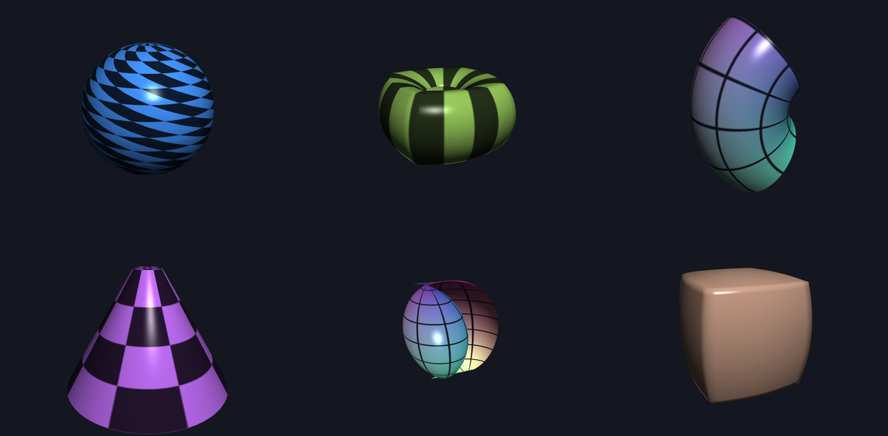

# Laboratório de Deformação

Projeto Final de Computação Gráfica (UDESC/CCT): **alteração de geometrias**.
Um programa em **C99 + OpenGL 3.3** onde você escolhe duas formas, **mistura**
uma na outra (morphing), aplica **deformações de Barr** (taper, twist, bend) e
usa **texturas** para ver onde a superfície estica e comprime, tudo por um
painel clicável (Nuklear) ou pelo teclado.



## O que tem

- 5 formas na mesma grade paramétrica (esfera, cubo, toro, cilindro, plano),
  então qualquer uma se transforma em qualquer outra;
- *Adicionar forma*: abre um modelo 3D seu (.obj), que é encaixado na mesma grade
  e passa a participar do morph e das deformações;
- mistura A/B com slider e animação automática;
- taper, twist e bend no vertex shader, com normais recalculadas numericamente;
- texturas xadrez, listras, grade UV ou uma imagem PNG/JPG sua (janela de arquivos ou arrastar);
- iluminação de Phong, modos sólido/malha, câmera orbital;
- *Exportar 3D*: salva a forma deformada em .obj (com material e textura) na pasta que você escolher.

## Compilar

Linux (Ubuntu/Debian):

```bash
sudo apt install build-essential cmake libglfw3-dev
make                      # ou: cmake -S . -B build && cmake --build build
```

Windows (MinGW, com GLFW instalado): `mingw32-make OS=Windows_NT`

As janelas de abrir/salvar arquivo usam o diálogo nativo no Windows e o
`zenity` (GNOME) ou `kdialog` (KDE) no Linux, que já vêm na maioria das distribuições.

## Rodar

```bash
./morph3d                 # rode a partir da pasta do projeto
./morph3d foto.jpg        # já abre com a imagem como textura
./morph3d --forma modelo.obj   # já abre com um modelo 3D seu como forma
```

Use o painel à esquerda, ou o teclado: `ESPAÇO` liga/pausa a animação, `←/→` controlam o morph,
`1`–`5` escolhem a forma (5 = Plano), `W` muda o desenho (sólido/malha),
`R` liga/desliga a rotação; arraste com o mouse para orbitar e use o scroll para dar zoom.
Arraste um PNG/JPG (textura) ou um .obj (forma) para a janela para usá-lo.

Controles completos, teoria e sequência de apresentação: [ROTEIRO.md](ROTEIRO.md).

## Bibliotecas de terceiros (em `external/`)

- [glad](https://github.com/Dav1dde/glad): carregador do OpenGL 3.3 core
- [Nuklear](https://github.com/Immediate-Mode-UI/Nuklear): interface gráfica (header único)
- [stb_image](https://github.com/nothings/stb): leitura de PNG/JPG
- [GLFW](https://www.glfw.org/): janela e entrada (instalada no sistema)
